  

  <b>[SCHOLAR]</b> <i>"Tell me about your work."</i> → <a href="https://www.linkedin.com/in/lucasngim%C3%A9nez/">LinkedIn</a>
  &nbsp;·&nbsp;
  <b>[JESTER]</b> <i>"I'll send a raven."</i> → <a href="mailto:lucasn.gimenez20@gmail.com">Email</a>

